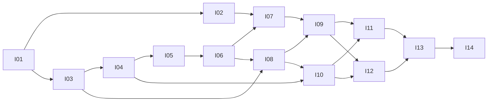

# マンガ下書き生成システム Issue駆動の実装計画

状態：v1モック版の引き継ぎ計画  
更新日：2026年10月18日

[実装仕様](implementation-spec.md)を実装するためのIssue本文を以下に定義する。I01〜I14はv1モック版、I15は後続の実API接続である。これらはローカルの識別子であり、GitHub Issueを作成済みという意味ではない。各節をそのままIssue本文に転記できる。外部Issueの起票、実装、リモートへの公開はこの計画書の作成には含めない。

## 実装担当者の作業契約

1. 本仕様と担当Issue、先行Issueの成果物を読む。先行Issueが未完了なら依存しない調査とmock実装のみ行い、推測で外部API接続を完成扱いしない。
2. 1 Issueを1つのレビュー可能な変更単位として実装する。全Issueで同じ実装仕様を使い、勝手な機能追加や技術置換をしない。
3. Issueの完了条件を意味のあるテストで確認し、実行コマンド、結果、残課題を記録する。mockとliveの結果を区別する。
4. 非対象の機能を持ち込まない。仕様変更が必要なら理由、影響、代案、移行方法をIssueに記録し、本仕様を更新してレビューする。
5. 受け入れ条件が満たせないIssueをcloseしない。API権限や課金設定がない場合は、該当live検証を未完了として残す。
6. APIキーやユーザー原稿をコミットしない。ローカルのDATA_DIR、成果物、ログを.gitignoreへ入れる。

設計書の採用条件は独立した2名のレビューでP0/P1がゼロとなること。レビュー対象の版と結果を[レビュー記録](design-review.md)に残す。実装時の変更は各PRで別途レビューし、この設計のPASSを実装のPASSとして扱わない。

## 優先順と依存関係

I02でローカルのプロバイダー契約と模擬APIを先に確定する。APIキーや実API利用権限なしでI01〜I14を完了できる。推奨順はI01→I02→I03→I04→I05→I06→I07→I08→I09→I10→I11→I12→I13→I14。I15はモック版引き渡し後の別作業とし、現在の依存グラフには含めない。

| マイルストーン | 成果 | 終了条件 |
| --- | --- | --- |
| M1 外部接続と保存 | I01〜I05 | 登録と入力固定ができ、模擬API契約が確認済み |
| M2 バッチと審査 | I06〜I09 | mockの大量生成、復旧、合否、修正再生成が成立 |
| M3 利用できるUI | I10〜I12 | 3画面、両テーマ、書き出しとバックアップが動作 |
| M4 リリース検証 | I13〜I14 | mock負荷試験、引き渡し用資料、実装レビューが完了。live不要 |

時間や金額の確約は置かない。プロバイダー境界を先行確定して手戻りを抑え、候補数1とmock中心の検証でAPI利用を抑える。v1では同期モード、Redis、SPA、複数ユーザー、カラー、人物シート自動生成を追加しない。

## I01 開発環境と実行コマンド

**依存**：なし。**対応仕様**：2、11。**対象**：pyproject.toml、uv.lock、src/manga_drawing、tests、CI、.gitignore。

**実装**：PythonパッケージとCLIを用意する。FastAPI/Jinja2、Pillow、Pydantic、uvicorn、multipart処理に必要な最小依存を固定する。開発用はpytest、ruff、Playwrightとする。web、worker、init、doctor、backupの入口を作り、未実装機能は明示エラーにする。DATA_DIR設定と環境変数、localhostバインドを実装する。

**完了条件**：新規checkoutでuv sync --lockedが成功し、initとdoctorとwebが起動する。APIキーがなくてもmockで起動できる。CIはruff check、pytest、OpenAPI生成を無料で実行する。DATA_DIRや秘密情報をGit管理しない。

**検証**：空の一時ディレクトリで初期化・再初期化、秘密情報なしの起動、設定不正を確認する。ネットワークなしで通常テストが動く。

**非対象**：生成エンジン、UIの完成、Docker。**完了時記録**：READMEの開発起動手順と確定した依存バージョン。

## I02 プロバイダー契約と永続化した模擬API

**依存**：I01。**対応仕様**：1、7.1、7.2。**対象**：providers/base、providers/mock、providers/gemini、docs/provider-contract.md。

**実装**：upload/submit/find/poll/fetch/parseのローカル契約を型で定義する。模擬APIにDATA_DIR/mock-provider配下の永続状態、PNG試験画像、仮想時計、障害scenarioを実装する。通常の完了待ちは2秒、pollは1秒とする。GeminiはProviderNotConfiguredを返すプレースホルダーとする。SDKや実APIキーを必要としない。

**完了条件**：workerの再起動後も同じ模擬外部IDで照会と結果取得ができる。成功、遅延、明示429、拒否、submit受理後timeout、混在結果、不正key、破損画像を再現できる。通常起動はmock、実APIの選択は登録や外部送信の前に拒否する。mockのschemaを実APIの検証済みschemaと記載しない。

**検証**：外部ネットワークを禁止したテストで全protocolを実行する。受理後timeoutからfindで1件の外部処理を回収し、送信数が増えないことを確認する。模擬画像をPillowで開ける。実API設定では予算予約・ジョブ・通信がゼロであることを確認する。

**非対象**：Gemini SDK接続、有料API検証、実際のAI作画。**完了時記録**：provider-contract.mdにローカル型、模擬scenario、後続I15で検証すべき実APIとの差分を記載する。

## I03 DBと不変ファイル保存

**依存**：I01。**対応仕様**：2、3、8。**対象**：db、assets、migrations。

**実装**：仕様のテーブルと制約、番号付きSQL migration、内容ハッシュによるasset保存、temp→fsync→rename、sidecar、画像検証とサムネイルを実装する。SQLite接続と短いtransaction helper、pages.versionのCASを用意する。個別モジュール専用の汎用repository層を増やさず、明示SQLで処理する。

**完了条件**：新規DBと既存DBのmigrationが再実行可能。FKとunique制約が有効。保存前の停止で候補が成功扱いされず、同じ内容のファイルを重複保存しない。画像原本と表示画像が区別される。

**検証**：異なるconnectionの更新競合、内容hash、画像破損、rename後の停止、重複挿入、未知migration版を確認する。T03/T09の保存部分。

**非対象**：ネットワーク送信、全テーブルのCRUD画面。**完了時記録**：DB schemaとDATA_DIR配置。

## I04 作品と資料の一括登録

**依存**：I03。**対応仕様**：4、10。**対象**：projects、assets、imports API、examples/minimal。

**実装**：manifestのschema、staging token、複数画像のstream保存、検証プレビュー、原子的なcommitを実装する。人物、シーン、ページ番号の対応と同番号更新のversionを検証する。登録後の共通設定・資料・page draft編集のサービスも実装する。自作の原稿と資料で動く小さなサンプルを用意する。

**完了条件**：100〜300ページをまとめて取り込める。人物不明やファイル不足をページごとに表示できる。commitの失敗で部分更新が残らず、再importしても採用・生成履歴が消えない。stagingだけを期限で掃除できる。

**検証**：T11。容量、画像pixels、パス逸脱、同番号と同pathの重複、変更競合、一部不足、修正後再登録を確認する。大量画像を全件メモリ展開しない。

**非対象**：ZIP入力、OCR、自動人物認識、人物シート生成。**完了時記録**：manifest schema、サンプル、登録方法。

## I05 決定的なプロンプトと入力版

**依存**：I04。**対応仕様**：3、5。**対象**：prompts、テンプレート、snapshot schema。

**実装**：通常構築と全文上書きの排他処理、固定送信順、累積修正欄、資料参照の版固定、canonical hashを実装する。余分なLLM呼び出しは使わない。

**完了条件**：同入力は同じ送信内容とhashになる。却下理由が勝手に送信されず、修正欄は1回だけ挿入される。直接編集した全文がそのまま送信テキストになる。draftや資料の変更が確定snapshotを変えない。

**検証**：T06。送信partsの順序と画像hashをfixtureで比較し、テンプレート変更がhashに反映され、日時と審査結果が影響しないことを確認する。

**非対象**：自動プロンプト改善、会話形式の編集。**完了時記録**：テンプレートの版と送信partsの例。

## I06 計画確定と費用を増やさないジョブ登録

**依存**：I05。**対応仕様**：3、6。**対象**：planning、plans/batches API、予算予約、POST retry。

**実装**：initial/revision/extraの選択、plan token、ページversion検査、Idempotency-Key、round/job登録、予算枠設定を実装する。対象確定後はID一覧と固定入力を使い、動的filterで後から対象を増やさない。

**完了条件**：二重送信と競合更新を検出し、登録が全部成功するか全部失敗する。同ページに進行中roundがあれば409。採用済みページはrevision対象外。追加生成は別roundとして区別される。手動再試行は元batch/jobに新attemptを作り、新batchを作らない。予算の単位、送信数上限、請求上限を保証しない旨がAPIから分かる。

**検証**：T02/T08のplanと登録部分。同じkeyの並列再送、payload違い、期限切れ、対象の途中編集、1ページの不正でrollback、候補数範囲を確認する。

**非対象**：料金自動取得、クレジット決済、請求額の保証。**完了時記録**：API例とidempotencyの保存仕様。

## I07 模擬APIへのチャンク送信と照会

**依存**：I02、I06。**対応仕様**：6、7。**対象**：worker、providers/gemini、providers/mock。

**実装**：最大1000要求/1GiBのチャンク、request key、外部同時8件、予算予約、submit前の永続化、poll、downloadを実装する。mockは同じprotocolを満たし、遅延・部分成功・unknown・拒否を指定できる。workerのOSロック、heartbeat、pauseも実装する。

**完了条件**：ブラウザやWeb停止中もworkerが処理し、再起動後は既知remote_nameを照会する。各要求が独立し、チャンク完了で順次取り込める。予算枠を超えて送信せず、pauseでも結果取得は進む。

**検証**：T01/T08。mock clockでpoll間隔、同時外部batch数、サイズ分割、複数作品の処理、キュー中のpauseを確認する。2つ目のworkerは起動拒否する。

**非対象**：同期生成、分散worker、外部batch cancel。**完了時記録**：worker起動・停止、設定一覧。

## I08 ページ審査と修正再生成

**依存**：I03、I06。**対応仕様**：5、6.2、9。**対象**：review、page review API、複合操作サービス。

**実装**：候補採用、最新round却下、却下理由と修正の分離、過去候補復元、version競合、修正して再生成の操作を実装する。候補はfixtureで供給してI07と独立に検証できるようにする。

**完了条件**：却下したページだけを対象にでき、採用済みの候補は明示解除以外で変わらない。古い審査要求は409。生成中の過去候補採用と旧結果の後着が規定通り。専用POSTで修正・却下・新ラウンド登録を原子的に行い、失敗時は全変更をrollbackして同じkeyで再実行できる。

**検証**：T05/T07。100ページ中7ページだけの再生成対象とhash、過去候補採用、採用解除を伴う却下、複合操作の各中断点を確認する。

**非対象**：AI審査、一括自動採用。**完了時記録**：状態遷移、API例。

## I09 障害復旧と結果の整合

**依存**：I07、I08。**対応仕様**：7.4、8。**対象**：worker recovery、結果解析、resolve API。

**実装**：unknownの照合・外部ID指定・明示再送、部分失敗の再試行、上限とbackoff、原子的取り込み、キー検証、起動時整合検査を実装する。孤立ファイルとDB成功後欠損も扱う。

**完了条件**：submitの成否不明を自動再送しない。0件照合を未送信の証明にしない。完了チャンクを再解析しても候補は増えない。成功済みjobは一切再生成せず、未知・不足keyは原因を表示する。失敗ページがあっても他ページが進む。

**検証**：T03/T04/T09。プロセスを実際に停止させる統合テストを少なくともsubmit受理直後とrename直後に用意し、再起動後の外部呼出し回数とDB/filesを確認する。mockの呼出し履歴で二重課金につながる再submitがないことを確認する。

**非対象**：外部APIにないexactly-once保証、unknownの無条件自動回復。**完了時記録**：障害分類と手動復旧runbook。

## I10 三画面のUIとテーマ

**依存**：I04、I08。**対応仕様**：9、10。**対象**：web、templates、static、ブラウザテスト。

**実装**：作品設定、一覧、詳細の3画面を実装する。通常操作は資料登録、生成開始、採用、修正、再生成、書き出し。内部ジョブ・予算・全文編集・過去候補は詳細領域へ置く。共通のAPIサービスを呼び、HTMLとJSONで別の業務ロジックを持たない。

**完了条件**：manifestから登録し、100ページ一覧を40件ずつ表示、候補比較と採否、7ページの修正保存と一括再生成までできる。pollは入力を壊さない。system/light/darkが保存され、原稿画像を変色させない。未保存編集を黙って捨てない。

**検証**：T10/T13のUI部分。両テーマの1280pxと360pxのスクリーンショットを保存して目視確認する。キーボードで一連の操作を完結し、主要色のコントラストとフォーカスを確認する。

**非対象**：独立SPA、画像への描画編集、複雑なダッシュボード。**完了時記録**：画面操作と実測アクセシビリティチェック。

## I11 UIとパイプラインの結合

**依存**：I09、I10。**対応仕様**：6、7、9、10。**対象**：progress API、各UI操作、受入E2E。

**実装**：進捗、送信停止、送信枠不足、ワーカー停止、unknown解決をUIに接続する。通常表示には次に必要な操作を示し、診断IDは詳細で確認できるようにする。非表示タブのpoll停止を実装する。

**完了条件**：生成開始→Webを閉じる→再表示→審査→修正ページだけ再生成の一連が動作する。失敗・unknown・予算不足を同じ「再試行」ボタンにまとめない。生成中や失敗中でも採用済みの画像を失わない。

**検証**：mockでT02/T04/T05/T07/T08/T10をブラウザ経由で通す。二重クリック、reload、2タブの競合、5秒poll中の入力を含める。

**非対象**：WebSocket、プッシュ通知、常駐デスクトップアプリ。**完了時記録**：利用者向けのエラーと対処一覧。

## I12 書き出しとバックアップ

**依存**：I09、I10。**対応仕様**：8、11。**対象**：export、backup CLI、download UI。

**実装**：採用snapshot、complete/accepted_only、グレースケールPNG、比率保持と白余白、フォルダーへの段階保存と完成後の公開、対応manifestを実装する。書き出しはworkerで処理し、backupはDBと参照ファイルを整合した形で保存する。

**完了条件**：実行途中の採用変更が書き出しを混在させない。未採用ページがcompleteで弾かれ、accepted_onlyには不足一覧が入る。復元後に入力・履歴・採用候補が維持され、進行中remote batchを照会再開できる。

**検証**：T11/T12。縦横比が異なる画像の寸法と白余白、ページ順、原本hashを確認する。新しいDATA_DIRへの復元試験を行い、模擬外部処理の同じIDをfind/pollで回収できることも確認する。フォルダー出力中にWebリクエストが応答し続ける。

**非対象**：PDF、PSD/CLIPレイヤー、クラウドバックアップ。**完了時記録**：バックアップと復元、書き出しの形式。

## I13 大量処理とローカル安全性の受入試験

**依存**：I11、I12。**対応仕様**：11、12。**対象**：tests/acceptance、負荷試験、Host/Origin/CSRF。

**実装**：T01〜T13を通した統合試験を整備する。安全性はlocalhostへの外部サイトからの書込、パス参照、ログの秘密漏洩、HTML escapeに絞る。分散基盤の負荷試験や網羅的な認証基盤を追加しない。

**完了条件**：100×3、300×1、300×3、障害注入、7ページ修正再生成が無課金で通る。一覧の初回40件、画像lazy load、最大RSSを実測する。512MiB目標を超えたら原因を修正または根拠と実用上限を明記して仕様変更レビューを受ける。外部Originからの書込と任意ファイル参照を拒否する。

**検証**：CIでruff check、pytest、Playwright。容量試験はstream生成した入力を使い、巨大fixtureをGitへ入れない。実行環境と時間、RSS、ジョブ件数、外部呼出し回数をレポートする。

**非対象**：実APIでの300枚負荷試験、マルチテナント脅威モデル。**完了時記録**：docs/acceptance-report.mdと既知の制限。

## I14 モック版の完成検証と実装引き継ぎ

**依存**：I02、I13。**対応仕様**：12。**対象**：mock受入、README、運用資料、最終レビュー。

**実装**：新しいDATA_DIRで起動から登録、バッチ、採否、7ページ修正再生成、書き出し、バックアップ復元を一通り確認する。模擬APIであることを画面と成果物に表示し、実APIの入口は無効にする。利用者向けに起動、登録、採否、修正、復旧を説明する。

**完了条件**：T01〜T13の証拠が揃い、実APIキーも外部通信も不要で全機能が動作する。独立した2名の実装レビューでP0/P1がゼロ、未解決P2にはIssueがある。「モック版完成・実API未接続」と明記して引き渡す。T14未実施はv1完成を妨げない。

**検証**：ネットワークなしの起動とE2E、原稿と模擬画像の表示、実API誤選択の拒否、復元後の再開を確認する。試験結果は模擬作画の品質保証として扱わない。

**非対象**：実SDK、有料API、カラー、一般公開。**完了時記録**：docs/acceptance-report.md、README、運用runbook、実装レビュー記録、I15の未実施項目。

## I15 実API接続と少数live検証

**依存**：I14。**対応仕様**：7.1、7.3、7.4、12。**対象**：providers/gemini、google-genai依存、live受入。現在のv1モック版の対象外。

**実装**：固定した公式SDKでGeminiのJSONL Batch接続を実装する。実引数、モデルとBatch対応、複数画像、出力画像の取得、display_key照合、ファイル期限、再試行無効化を確認する。初めに2ページの少数試験で成立性を検証し、T14で片方だけを修正再生成する。

**完了条件**：SDK版、日時、外部ID、送信数、秘密情報を除いた実schemaとfixtureを記録する。T14の計3要求で再生成対象外の採用hashが不変。アカウントの制限にプロファイルを適合し、実API対応版として独立レビューを通す。推測した実接続を完成扱いしない。

**検証**：明示liveフラグ、APIキー、送信予算枠なしでは送信しない。SDKの暗黙submit再送がないことを確認する。認証情報と実原稿はコミットしない。大量処理と障害の再現はmock試験を再利用する。

**非対象**：実APIでの大量負荷試験、複数プロバイダー、同期モード。**完了時記録**：provider-contract.md、価格と制限の確認日、acceptance-report.md、実API対応の手順。権限や予算がない場合はI15だけ未完了として残す。

## テスト追跡表

| 仕様の試験 | 主担当Issue |
| --- | --- |
| T01 大量処理 | I07、I13 |
| T02 重複登録 | I06、I11 |
| T03 クラッシュ復旧 | I03、I09 |
| T04 unknown | I09、I11 |
| T05 却下ページ限定 | I08、I11 |
| T06 プロンプトの版 | I05 |
| T07 審査競合 | I08、I11 |
| T08 送信枠 | I06、I07、I11 |
| T09 結果不正 | I03、I09 |
| T10 UI | I10、I11 |
| T11 入出力 | I04、I12 |
| T12 復元 | I12 |
| T13 一覧とメモリ | I10、I13 |
| T14 少数live | 後続I15のみ。v1完成には不要 |

## 完了報告の様式

各Issueの報告は、変更した振る舞い、主要ファイル、実行した検証と結果、未解決の制限、更新した仕様を記載する。mockで通った項目とliveで通った項目を分ける。実装担当者の自己申告だけで採用せず、実行証拠をレビュー可能にする。
