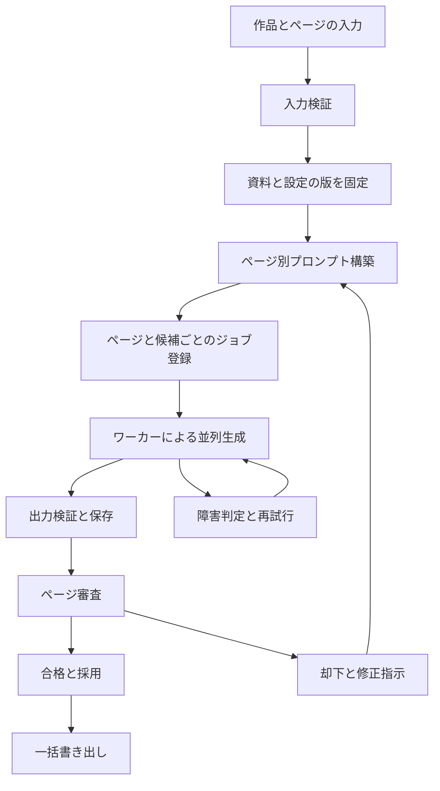

# マンガ下書き生成システム 仕様設計の骨子

作成日：2026年10月18日  
状態：設計草案

実装時は[実装仕様](implementation-spec.md)と[Issue駆動の実装計画](implementation-plan.md)を優先する。初期版は模擬APIでアプリ全体を完成させ、実API接続は後続I15へ分離する。本書にあるGemini非同期Batch APIは後続接続時の方針とする。結果は完了したチャンクから審査できる。人物資料は既存シートの登録を対象とし、シート自動生成は初期版の対象外とする。

人間が描いたネームと演出指示から、清書に使う下書きを数十〜数百ページ単位で生成する。ユーザーは各ページを審査し、却下したページのプロンプトを修正して再生成できる。内部処理は役割ごとに分離し、ユーザーには資料登録、生成、審査、書き出しの簡単な操作を提供する。

## 目的と対象範囲

作者がページ設計と最終的な清書を担い、その間の下書き制作を高速化する。ネームのコマ割り、吹き出し、視線誘導、人物配置、演出を尊重し、作者が清書しやすい画像を生成する。

初期実装はモノクロ漫画を対象とする。カラー向けの画面、生成処理、色の一貫性管理は実装しない。設定とプロンプトの構造には将来表現モードを追加できる余地を残す。

| 区分 | 内容 |
| --- | --- |
| 合意済み要件 | 大量ページのバッチ処理、並列生成、中断再開、失敗時の復旧 |
| 合意済み要件 | ページごとの合否、却下ページのみ再生成、プロンプト修正 |
| 合意済み要件 | 簡潔なブラウザUI、ライトとダークの切り替え、内部処理の分離 |
| 初期構成案 | Python、SQLite、ファイル保存、独立した生成ワーカー |
| 詳細設計で決定 | UIフレームワーク、画像生成APIとモデル、実行環境、API固有の制限 |

## 入力と成果物

| 単位 | 入力または設定 |
| --- | --- |
| 作品 | ページ順、共通作画ルール、出力寸法、候補数 |
| 人物 | 固定ID、名前、身長、確認済みデザインシート |
| シーン | 場所、時間帯、衣装、継続する人物や物の状態 |
| ページ | ネーム画像、指示書画像、登場人物、シーン参照、演出テキスト |
| 再生成 | 却下理由、修正指示、必要に応じて直接編集したプロンプト |

指示書は視線誘導、番号、人物名を中心とし、詳細な演出は番号に対応するテキストで記述する。既存の人物資料を登録するだけで生成を開始できる。人物スケッチからのデザインシート生成は補助工程とし、ユーザーが確認した資料をページ生成に使う。

成果物は各ページの生成候補、採用画像、送信プロンプト、入力資料の版、生成条件、審査履歴とする。採用画像をページ順に一括書き出しできるようにする。生成物とユーザーの原稿資料はGit管理のソースコードと分けて保存する。

## 利用の流れ

1. 作品を作成し、人物資料と各ページのネーム、指示書、演出を登録する。
2. 入力不足を確認し、対象ページと候補数を指定してバッチ生成を開始する。
3. 生成されたページから順に、ユーザーが候補を確認する。
4. 採用する候補を選んで合格にするか、却下して修正内容を保存する。
5. 修正したページを個別に再生成するか、要修正ページをまとめて再生成する。
6. 新しい候補を再審査し、採用画像を一括書き出しする。

全ページの生成完了を待たずに、完了したページを審査できる。画面を閉じても処理を継続し、開き直した際に保存済みの進捗を表示する。

## パイプラインと処理境界

| 内部モジュール | 責務 |
| --- | --- |
| 作品と資料管理 | 人物、シーン、ページ、入力資料の版を管理する |
| 入力検証 | 不足ファイル、未登録人物、設定の矛盾を検出する |
| プロンプト構築 | 共通ルール、ページ演出、修正指示を統合し版を保存する |
| バッチ制御 | 対象の確定、依存関係、キュー登録、並列数と実行頻度を管理する |
| 画像生成 | プロバイダーごとの要求送信、状態照会、結果取得を担う |
| 障害復旧 | エラー分類、再試行待ち、中断後の処理回収を担う |
| 審査管理 | 合否、却下理由、採用候補、修正内容を管理する |
| 成果物管理 | 画像と履歴を保存し、採用画像を書き出す |
| UIとアプリケーションAPI | ユーザー操作を受け付け、各処理を呼び出す |

UIやHTTPリクエストの処理内で長時間の画像生成を実行しない。生成ワーカーは独立して起動する。初期構成は単一マシンを想定し、分散構成が必要になった際にキューと保存先を交換できる境界を設ける。

## バッチ生成と依存関係

100ページを3候補ずつ生成する場合、300件の生成ジョブとして登録する。人物資料とシーン設定の準備後は、各ページを原則独立して生成する。前ページの生成完了を次ページの開始条件にしない。

バッチ開始時に対象ページ、入力資料、プロンプト、モデル設定を固定する。実行途中の編集は次回の生成に適用し、実行中の条件を変えない。未準備のページは理由を示して対象外にし、準備済みのページを処理できるようにする。

並列数と単位時間あたりの要求数を制御する。プロバイダー提供の非同期バッチAPIにも接続できる構造にするが、採用APIの仕様は詳細設計で確認する。

入力ファイルの内容、プロンプト、資料の版、モデル設定から入力ハッシュを作る。同条件での再開では成功済みジョブを再利用する。ユーザーが明示的に追加生成した場合は、新しいジョブとして登録する。同じ入力条件でも同じ画像になることは保証しない。

## ページ審査と再生成

ページの合否と、候補を生成するジョブの成否を分けて管理する。

| 管理対象 | 状態 |
| --- | --- |
| ページ審査 | 未生成、審査待ち、合格、却下 |
| 生成ジョブ | 待機、実行中、再試行待ち、成功、失敗、結果確認待ち |

再生成中かどうかは関連ジョブから表示する。画像生成の成功によって合格にはならない。ユーザーが候補を採用すると合格になる。複数候補がある場合は、いずれかを採用するか、ページを却下して再生成する。

却下理由は審査記録、修正指示は次の生成入力として別に保存する。修正なしでの再生成も可能とする。要修正ページをまとめて再生成する際は、未保存の編集がない状態で対象を確定する。合格済みページは通常の再生成対象に含めない。

ページの版ごとに入力資料、送信プロンプト、モデル設定、生成候補、合否と理由を紐付け、上書きしない。過去の候補を採用し直せるようにする。

古い版のジョブが後から完了しても、最新の審査結果や採用画像を自動で置き換えない。審査は候補IDと版に対して保存し、候補の取り違えを防ぐ。

## プロンプトの編集と共通設定

通常操作ではページごとの修正内容を入力し、元の演出と組み合わせて次のプロンプトを構築する。詳細設定では送信プロンプト全体を確認し、直接編集した版を保存できるようにする。直接編集した場合も、実際に送信した全文を記録する。

共通テンプレートには以下の要求を含める。

- 枠線と吹き出しの位置と形を優先する。
- 視線誘導、人物配置、カメラアングルを尊重する。
- 登録したデザインシートと身長を参照する。
- 指示書の番号、矢印、色文字を出力に描き込まない。
- 背景をページの演出指示に従って補う。
- モノクロの下書きとして出力する。

これらは生成への要求であり、画像の品質や意図の再現性はユーザーが判断する。共通資料を変更した際は影響するページを特定し、再生成対象を選べるようにする。合格済みページを自動で再生成しない。

## 障害からの復旧

| 状況 | 動作 |
| --- | --- |
| 一時的な通信障害や利用制限 | 待ち時間を増やしながら上限回数まで再試行する |
| 不正な入力や生成拒否 | 原因を保存し、自動再試行を止めて修正可能にする |
| 送信後のタイムアウト | 結果確認待ちにし、APIが対応する場合は要求IDで照会する |
| 状態照会できず成否が不明 | 無条件に再送せず、重複生成の可能性を表示して再試行を選べるようにする |
| アプリやワーカーの停止 | 永続化した状態から未完了ジョブを回収して再開する |
| 出力画像の破損や未取得 | 成功扱いせず、取得または生成の再試行を判断する |

ワーカーによるジョブ取得を排他的に行い、実行中の所有期限を管理する。期限切れジョブは外部APIの状態を確認して回収する。再開やボタンの二重操作で同一ジョブを重複登録しない。

結果画像は一時保存後に検証し、保存完了後に成功を記録する。画像とDBの記録が食い違った場合に整合を回復できるよう、ジョブIDで保存先を特定する。

作画内容の却下は通信障害の自動再試行には含めず、新しい入力版による生成として扱う。

## 出力検証と書き出し

画像が開けること、取得が完了していること、実際の幅と高さを自動検証する。原稿の希望寸法と、生成APIが対応する出力寸法は別の設定として管理する。

寸法調整時は元画像を保持し、コマや吹き出しを自動で切り取らない。リサイズや余白付加の方法は詳細設計で決定する。画像の構図や人物の一貫性は自動検証のみで合格にしない。

書き出しにはページ順と採用候補の対応表を付ける。未採用ページがある場合は不足を表示し、採用済み分だけを書き出す操作と区別する。

## 画面構成と操作

### 作品設定

人物資料、シーン、ページ資料をまとめて登録する。通常は作品名、入力資料、候補数と生成開始を中心にし、並列数やモデル設定は詳細設定に収める。

### ページ一覧

サムネイルをページ順に並べ、生成中、確認待ち、採用済み、要修正、エラーを表示する。状態による絞り込み、対象選択、要修正ページの一括再生成、採用画像の書き出しを提供する。数百ページでも全解像度の画像を一度に読み込まず、サムネイルと段階的な読み込みを使う。

### ページ詳細

ネームと生成画像を並べ、指示書も確認できるようにする。主要操作は「採用する」、修正内容の入力、「修正して再生成」とする。却下を記録して修正を保存し、一覧からまとめて再生成することもできる。

候補切り替えと拡大表示を用意する。過去の版、却下理由の詳細、プロンプト全文、モデル設定は詳細領域に収める。通信障害のページには修正入力とは別に再試行を表示する。

### 見た目とテーマ

[デジタル庁デザインシステムの基本デザイン](https://design.digital.go.jp/dads/foundations/)を参考に、本アプリの画面を設計する。

- 直線的な配置、小さな角丸、細い区切り線を使い、影と装飾を最小限にする。
- 白とグレーを基調とし、主要操作に青を使う。
- 日本語の読みやすさ、文字の強弱、余白で情報を整理する。
- 状態は色だけで区別せず、文字とアイコンを併用する。
- キーボード操作、フォーカスの可視性、文字と境界線のコントラストを確認する。

ライトとダークを切り替えられるようにする。初期状態はOSの設定に合わせ、手動で選択したテーマは保存する。ダークの配色は本アプリ用に設計する。テーマ変更で原稿画像を反転したり着色したりせず、周囲のUIだけを切り替える。

## 保存するデータ

| データ | 主な内容 |
| --- | --- |
| 作品 | ID、ページ順、共通設定 |
| 資料の版 | 人物やシーンのID、ファイル参照、内容ハッシュ |
| ページ | ID、順序、参照資料、現在の審査状態、採用候補ID |
| ページ入力の版 | ネーム、指示書、演出、修正指示、共通資料の版 |
| プロンプトの版 | ページ入力の版、テンプレートの版、送信全文 |
| バッチ | 対象ページ、候補数、固定した条件、進捗 |
| 生成ジョブ | 対象候補、状態、入力ハッシュ、実行所有期限 |
| 生成試行 | 外部要求ID、開始終了時刻、エラー、生成設定 |
| 生成候補 | 画像保存先、寸法、対応するジョブと入力版 |
| 審査 | 対象候補と版、合否、理由、判定時刻 |

APIキーは環境設定で扱い、プロンプト履歴や書き出しファイルに含めない。

## 実装段階と受け入れ条件

| 段階 | 成果と確認内容 |
| --- | --- |
| 入力と版管理 | 人物、シーン、ページ資料を登録し、不足を検出して入力セットを確定できる |
| バッチ基盤 | 模擬プロバイダーで100ページ×3候補を処理し、中断再開と失敗分だけの再実行を確認する |
| 実API接続 | 少数ページで入力資料の伝達、画像取得、寸法、エラーの扱いを確認する |
| 審査と修正 | ページごとに合否を保存し、プロンプト修正後に却下ページだけ再生成できる |
| UIと書き出し | 3画面で操作を完結し、両テーマで審査と一括書き出しができる |

最初の完成条件は、100ページ×3候補を投入し、中断再開と障害復旧を行い、ユーザーがページ単位で審査した後、却下ページだけを修正して再生成し、採用画像をページ順に取り出せることとする。

検証では、生成中の入力編集、ボタンの二重操作、古いジョブの遅延完了、再生成後の過去候補の採用も扱う。生成待ち時間とユーザーの操作時間を分けて記録し、制作時間短縮の評価に使う。

## 参照資料

- [原記事のGoogleドキュメント](https://docs.google.com/document/d/1pzfVnZF5nxGzZ95Ugf1lwfbysnz1AsSdXJ-3pvQkFtw/edit?tab=t.0)
- [公開されたnote版](https://note.com/masa_san_jp/n/n21a5c02f496f)
- [デジタル庁デザインシステムの基本デザイン](https://design.digital.go.jp/dads/foundations/)

本設計は記事の制作方法をソフトウェアへ展開するための仕様草案とする。記事中のプロンプトや画像の転載は本設計の範囲に含めない。
