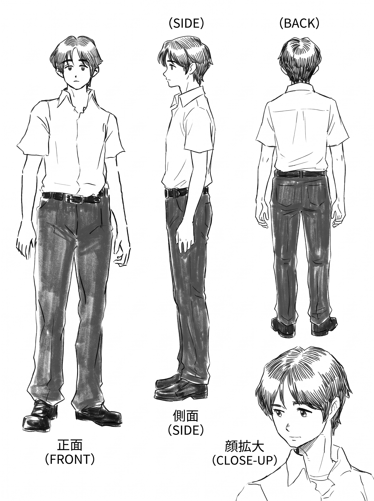
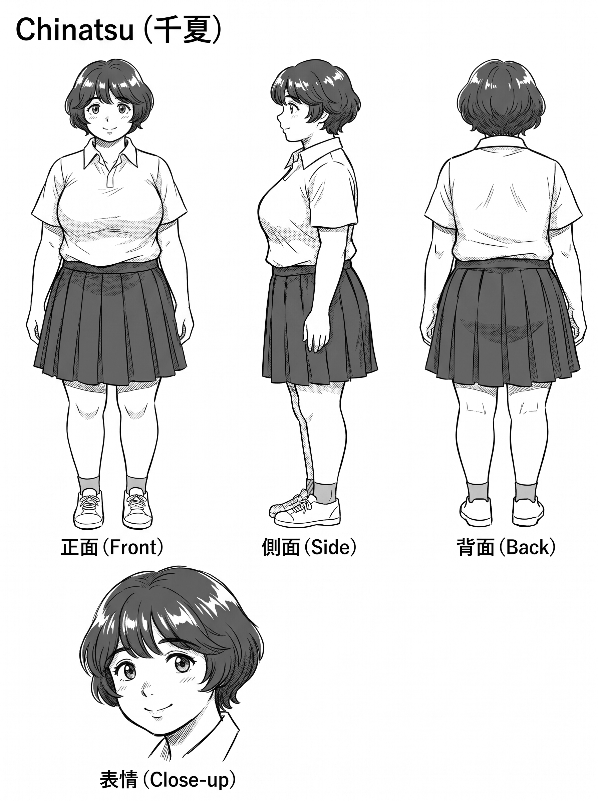
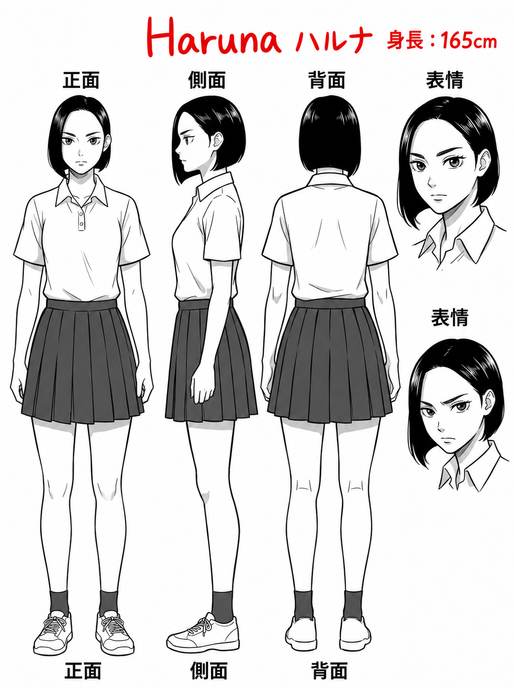
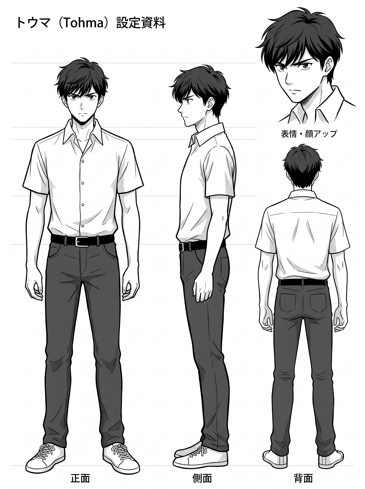
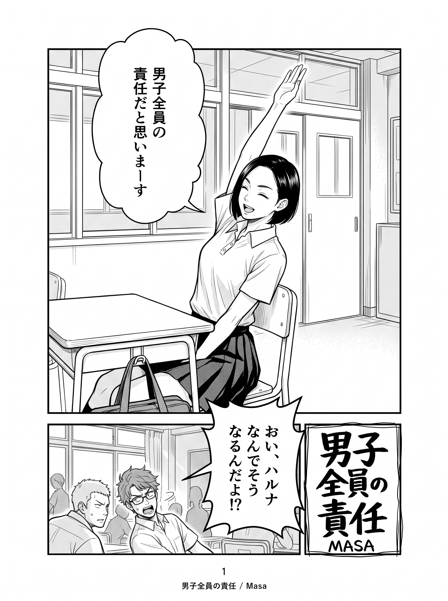
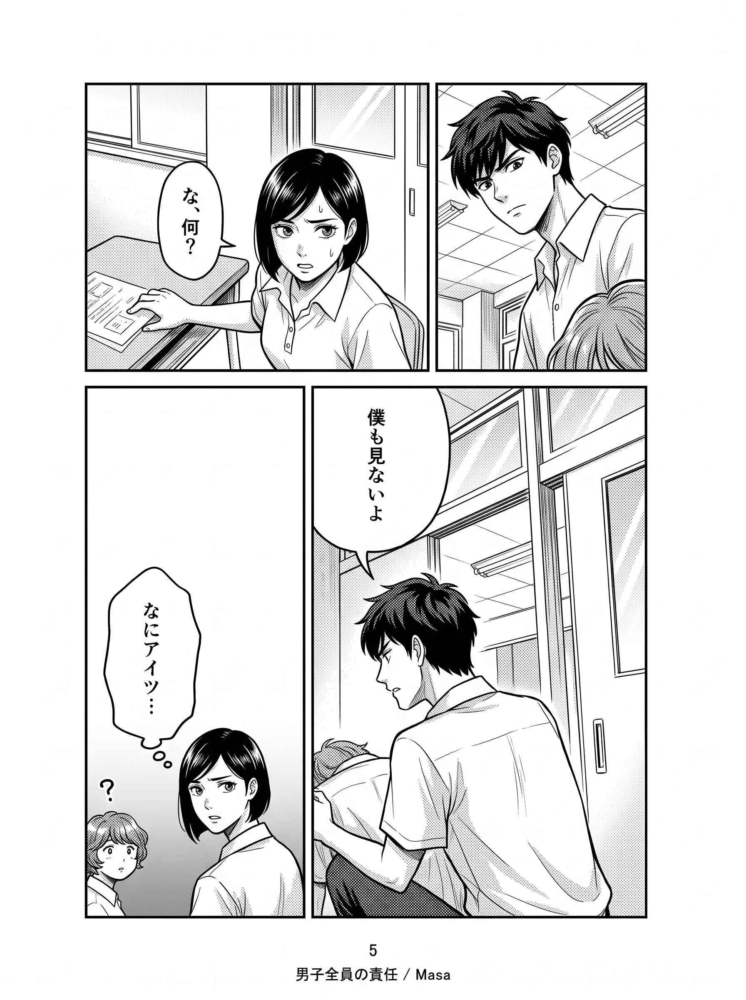

# 作例001

4人のキャラクタースケッチからリファレンスを作成し、ネーム・指示書・作者のプロンプトを使って漫画8ページを生成した作例です。

[アプリの画面](../../README.md#アプリの画面) · [入力資料](manifest.json) · [生成記録](下書き/生成記録.json)

## キャラクターリファレンス

Harunaは元ドキュメントの指定に従い、名前と「身長：165cm」を赤字で追記しました。アプリで今後の作画に使う画像も更新済みです。ほかの3人の身長は未指定のため、推測して記入していません。

| Akihiko | Chinatsu |
| --- | --- |
|  |  |

| Haruna | Tohma |
| --- | --- |
|  |  |

身長の追記は以下のページ画像を生成した後です。以下は追記前のリファレンスを使った最新画像で、追記後に漫画を再生成したものではありません。生成時の元画像は各人物フォルダーの「テイク01.png」、追記内容は[追記記録](キャラクターリファレンス/Haruna/追記記録.json)に残しています。

## 下書き8ページ

各ページの最新生成画像です。1・5ページはテイク4、ほかはテイク3です。1ページのテイク4は採否未判定、残り7枚は採用済みです。ユーザーの採否は変更していません。1ページで現在採用されている画像はテイク1です。

| 1ページ · テイク4 · 採否未判定 | 2ページ · テイク3 · 採用済み |
| --- | --- |
|  |  |

| 3ページ · テイク3 · 採用済み | 4ページ · テイク3 · 採用済み |
| --- | --- |
|  |  |

| 5ページ · テイク4 · 採用済み | 6ページ · テイク3 · 採用済み |
| --- | --- |
|  |  |

| 7ページ · テイク3 · 採用済み | 8ページ · テイク3 · 採用済み |
| --- | --- |
|  |  |

[実際の生成指示と画像](下書き/) · [生成記録](下書き/生成記録.json) · [プロンプト原文と出典](../../docs/source-prompts/README.md)

記事の1〜6ページは対応する原文を使用し、7・8ページはプロンプト1を共通本文として使っています。テイク4にはユーザーが入力した修正指示も含まれます。候補画像をそのまま掲載しているため、採用画像の書き出し時に行う1410×1920pxへの整形前です。

## 入力資料

| フォルダー | 内容 |
| --- | --- |
| キャラクタースケッチ | 4人の元資料 |
| キャラクターリファレンス | 設定画・生成指示・追記記録 |
| ネーム | 8ページのコマ割り・セリフ・配置 |
| 作画指示書 | 8ページの画像による指示 |

## アプリでの手順

1. このフォルダーを選び、manifest.jsonと入力資料を登録。
2. キャラクター画面でリファレンスを生成・確認し、使用する画像を採用。
3. ページ一覧からまとめて生成。
4. ページごとに採否を判定し、作画指示・修正内容を入力して必要なページだけ再生成。
5. 採用画像を書き出す。
