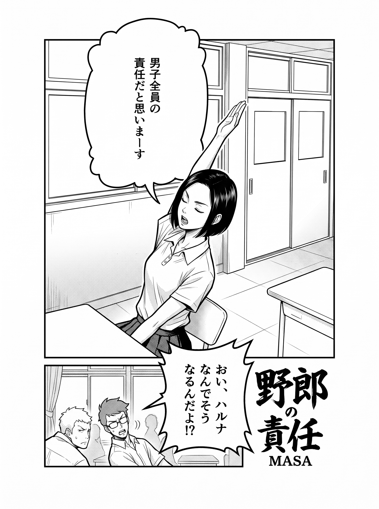
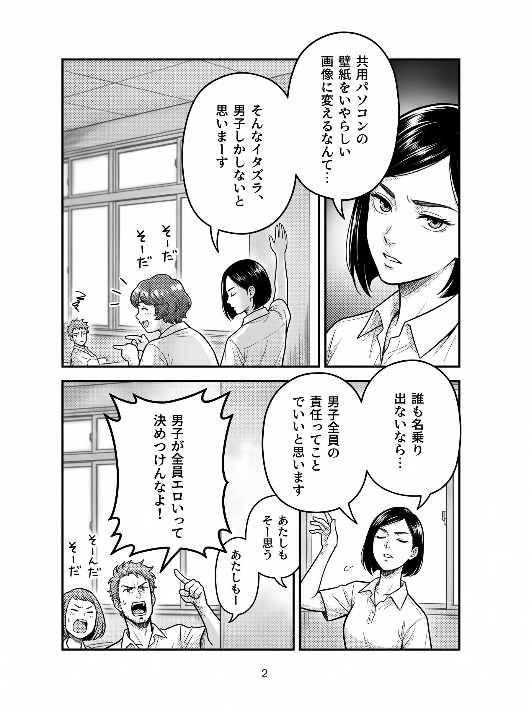
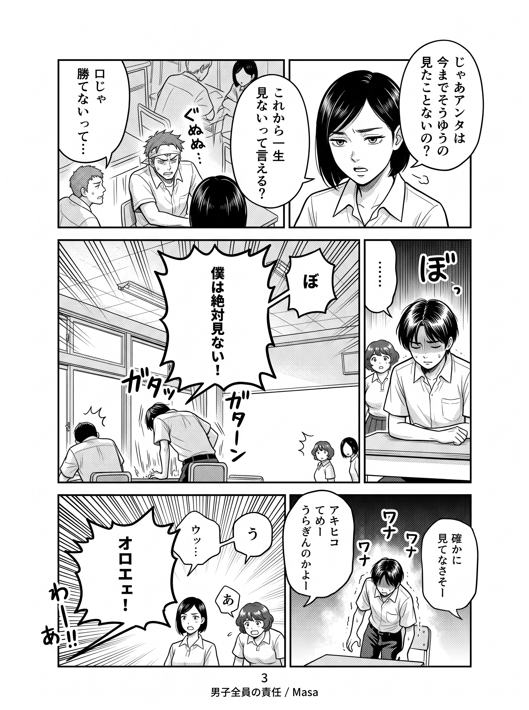
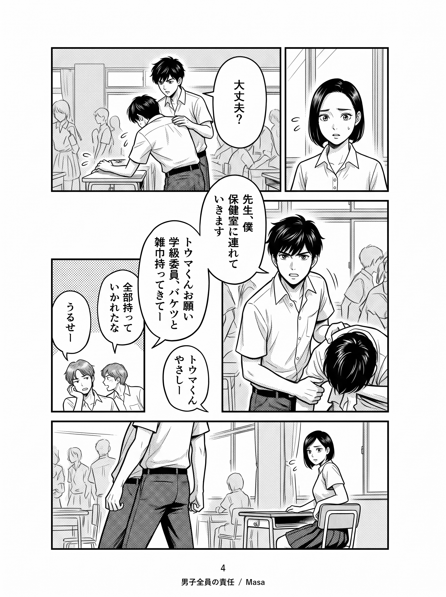
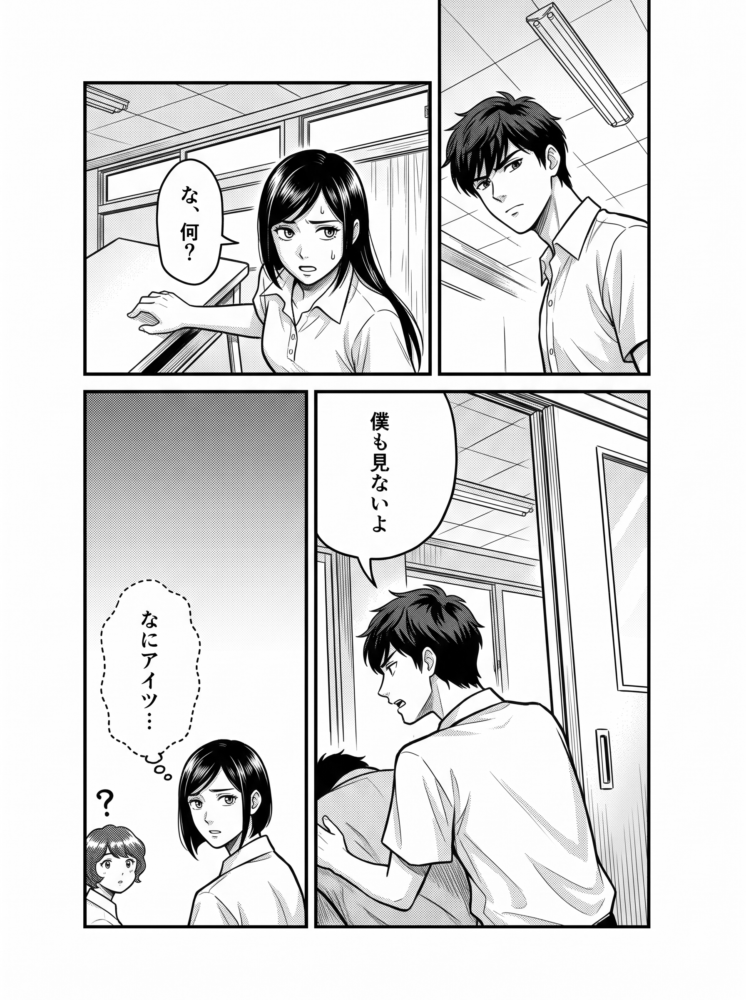
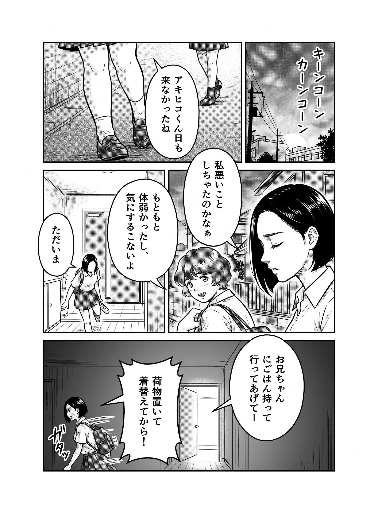
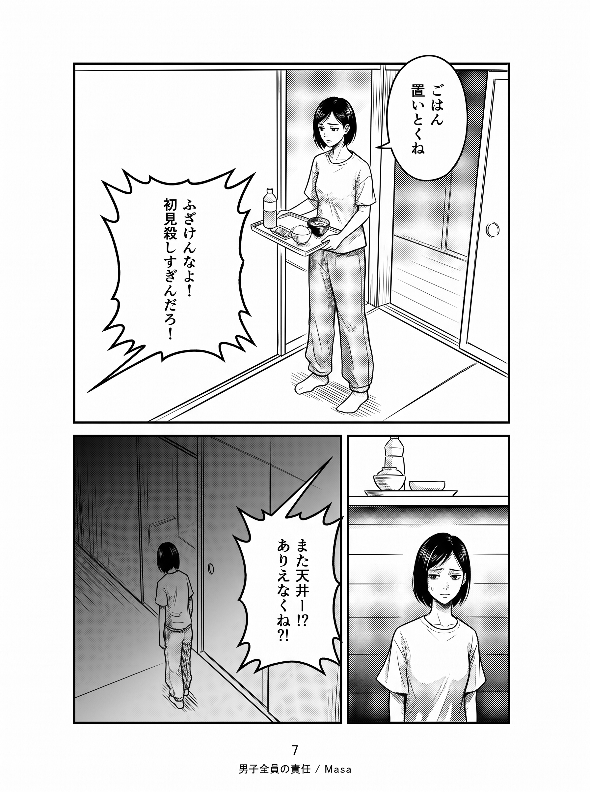
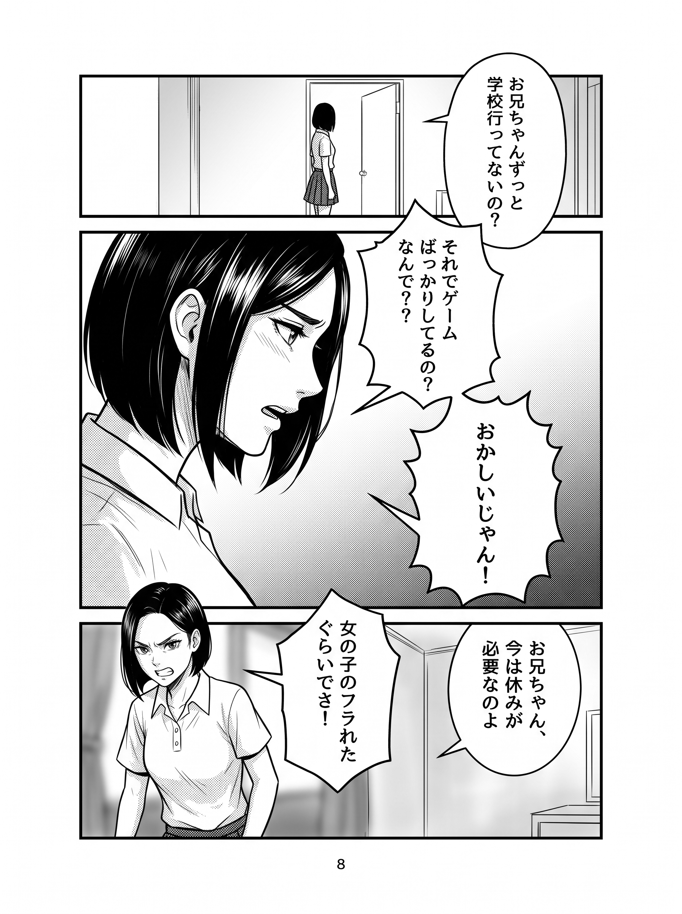

# 作例001

作者の入力資料とプロンプトを使い、アプリの通常のバッチ生成で制作する作例です。

## 下書き8ページ

**全8ページを、復元した原文で再生成しました。最新はテイク3・採否未判定です。** 画像をクリックすると原寸で開きます。

使用した本文は、記事の1〜6ページそれぞれの原文です。7・8ページ固有の原文は資料にないため、プロンプト1を共通本文として使用しています。独自の優先順位やsystemInstructionは追加していません。Notionの2種類のシステムプロンプトはドキュメントへ保存していますが、今回の本文には混ぜていません。

[実際の生成指示](下書き/)・[生成記録](下書き/生成記録.json)・[プロンプトの出典と原文](../../docs/source-prompts/README.md)を確認できます。掲載画像はアプリの候補画像と同じバイト列です。採用後の書き出しではありません。

| 1ページ · テイク3 | 2ページ · テイク3 |
| --- | --- |
|  |  |

| 3ページ · テイク3 | 4ページ · テイク3 |
| --- | --- |
|  |  |

| 5ページ · テイク3 | 6ページ · テイク3 |
| --- | --- |
|  |  |

| 7ページ · テイク3 | 8ページ · テイク3 |
| --- | --- |
|  |  |

## 確認できたこと・残る問題

全8件の送信本文と原文の一致、採用済みキャラクターリファレンスの添付、画像の保存を確認しました。一方、3ページの集中線追加、6ページの小さい人物の顔の省略などは残っています。原文を送信できたことと、画像が作者の要求を満たすことは区別します。作者の採否は変更していません。候補画像の実寸は1792×2400pxで、原文指定の1410×1920pxとは異なります。採用画像の書き出し時にアプリが1410×1920pxへ整形しますが、ここには整形前の候補を掲載しています。

## 入力資料

| フォルダー | 内容 |
| --- | --- |
| キャラクタースケッチ | 4人の元資料 |
| キャラクターリファレンス | 採用した4人の設定画・生成指示 |
| ネーム | 8ページのコマ割り・セリフ・配置 |
| 作画指示書 | 8ページの画像による指示 |

## アプリでの手順

1. このフォルダーを選び、manifest.jsonと入力資料を登録。
2. キャラクター画面でリファレンスを生成し、使用する画像を採用。
3. ページ一覧から未生成ページをまとめて生成。原文はmanifest.jsonのprompt_overrideから登録されます。
4. ページごとに採用・要修正を判定。全文指定中の修正は、詳細画面に表示される「送信プロンプト全文」を編集。
5. 要修正ページを再生成し、採用画像を書き出す。

テイクは各ページの生成回です。今回の再生成も通常の候補追加処理を使い、元のページ・採用リファレンスを維持しています。旧手順の公開画像は撤去し、公開フォルダーには最新のテイク3を掲載しています。
