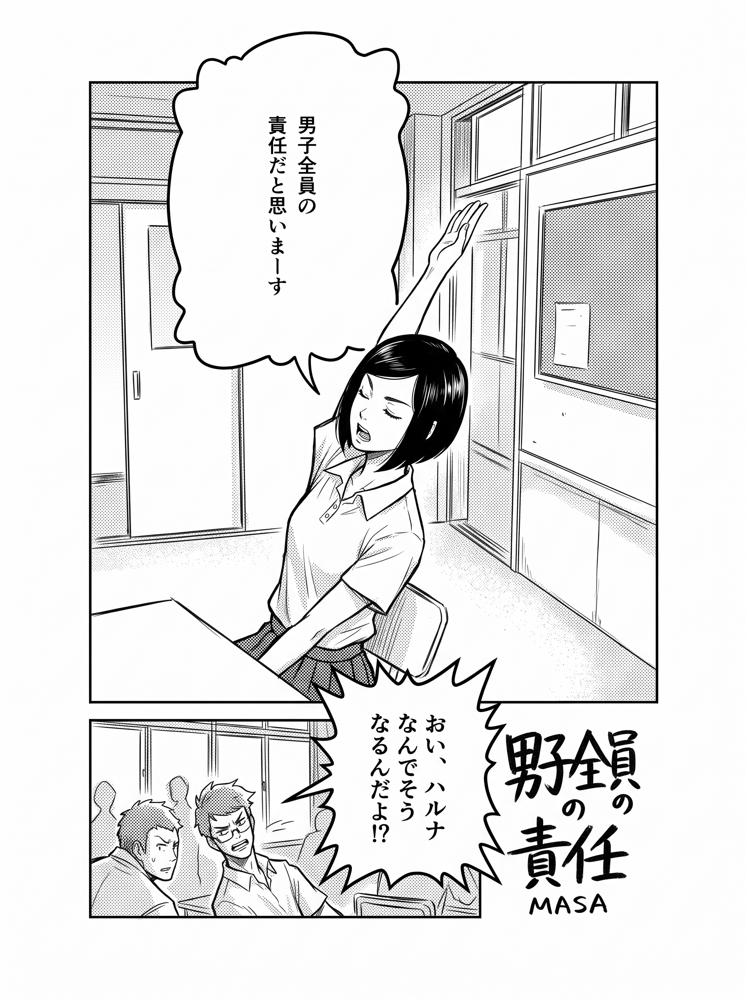
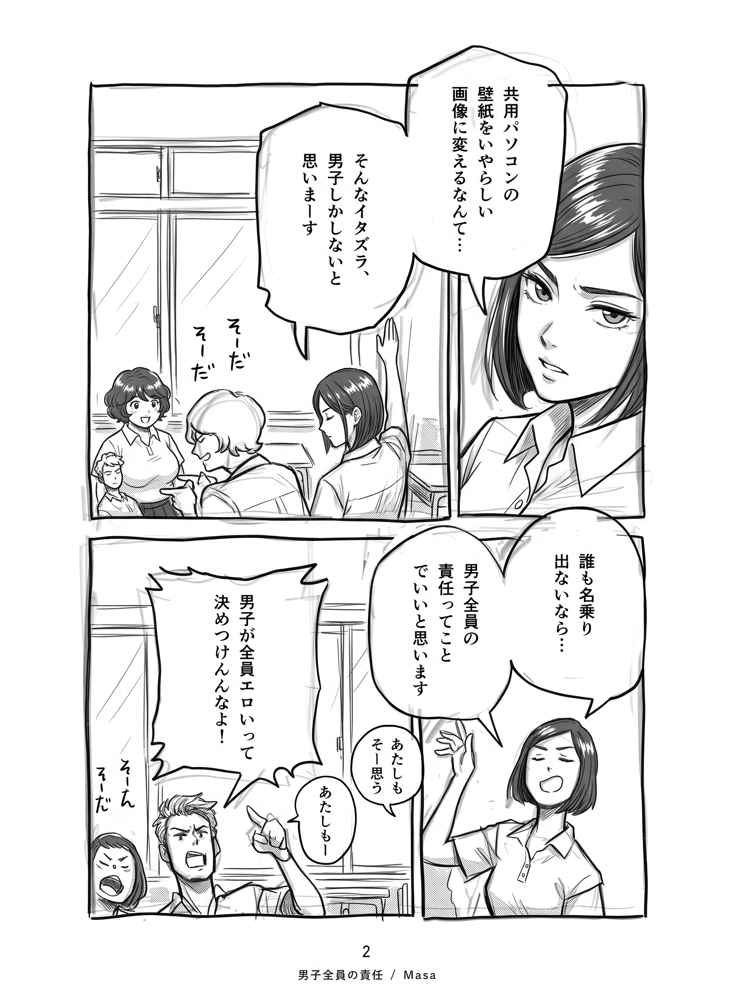
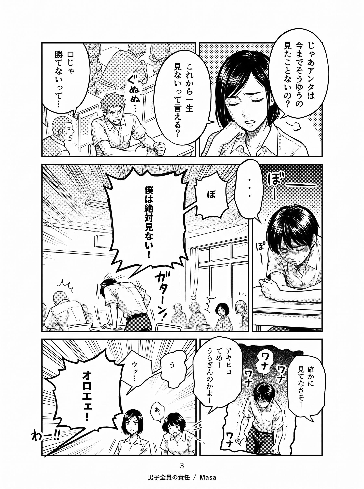
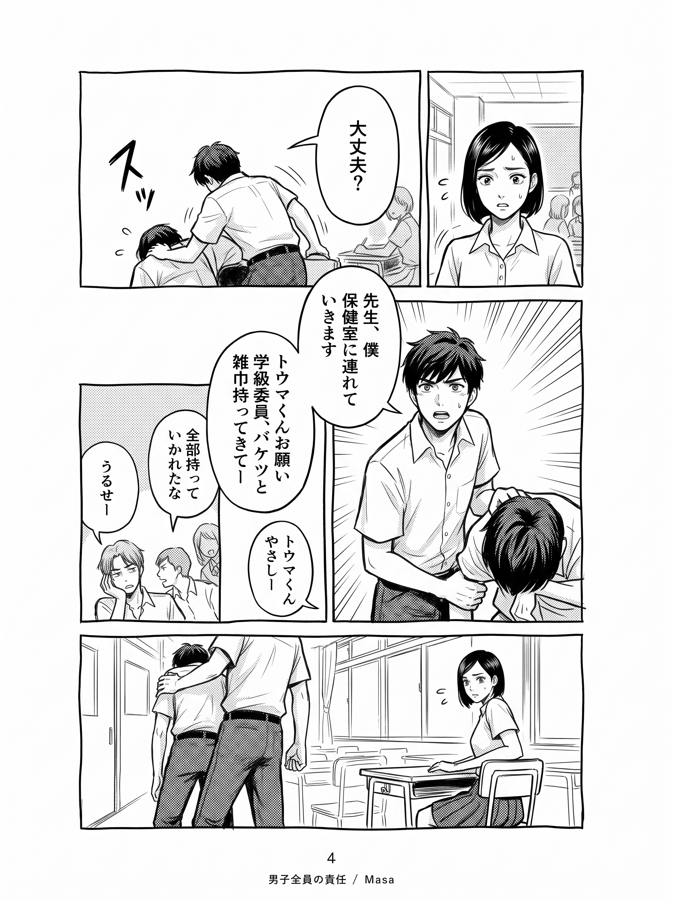
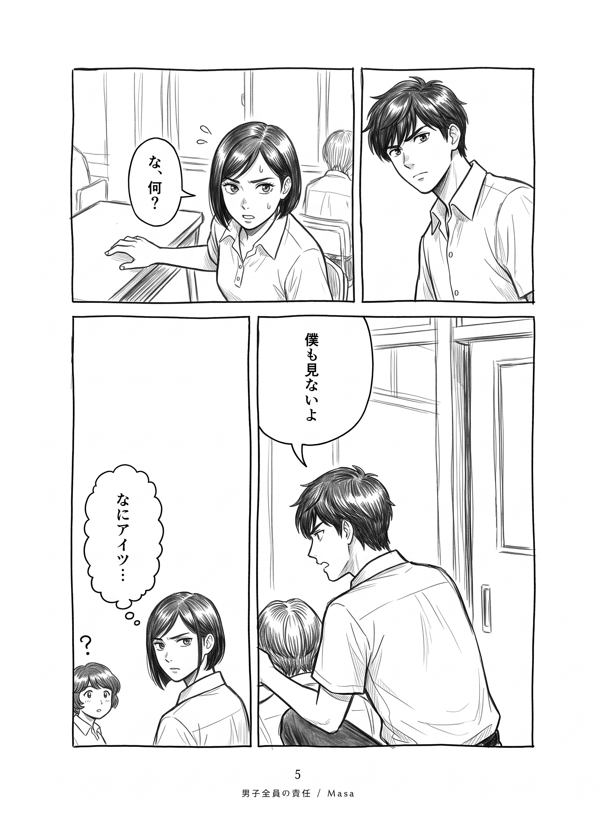
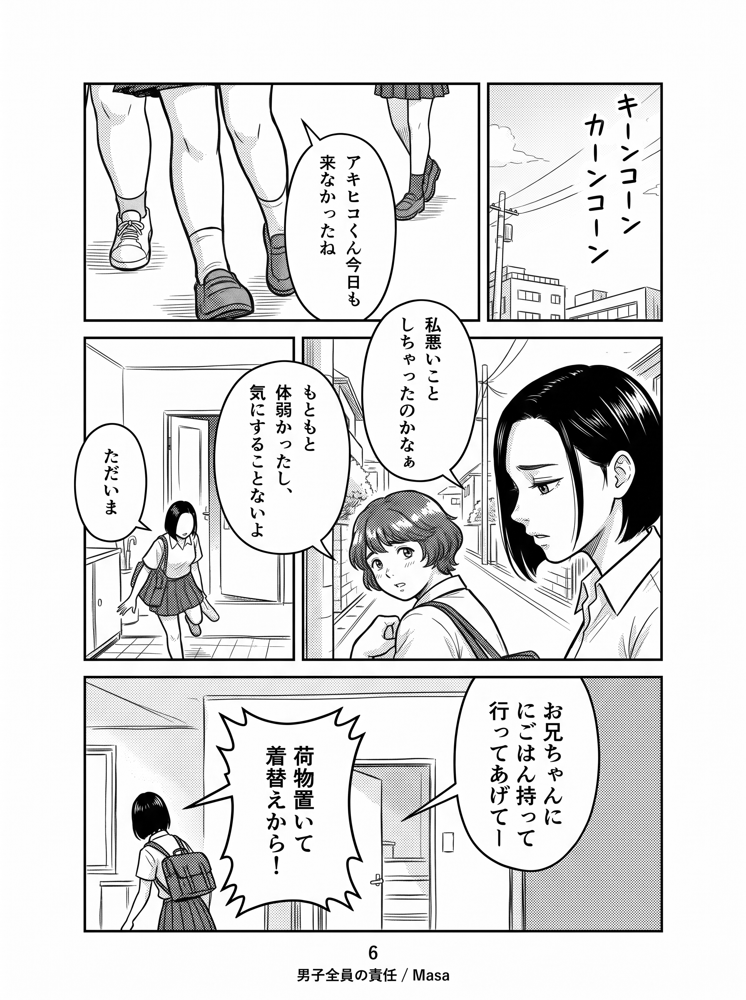
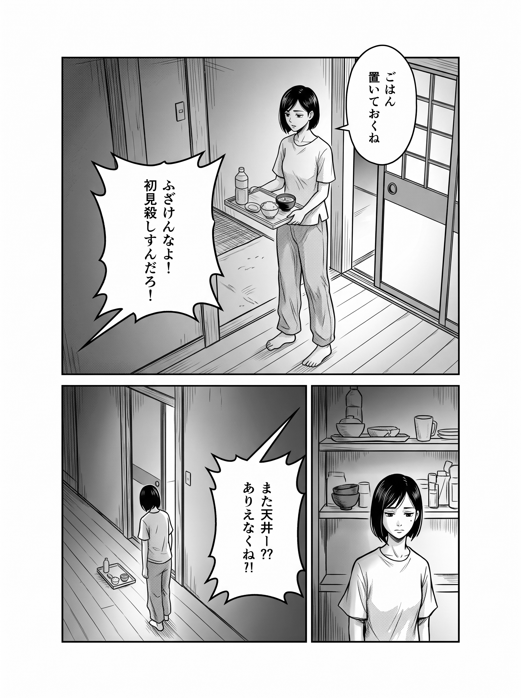
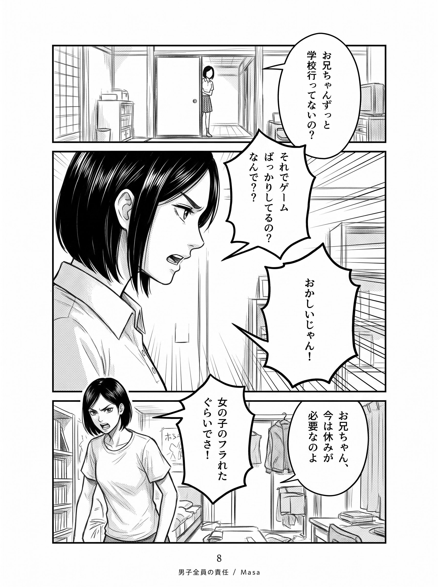

# 作例001

実際の制作資料を、通常のアプリと同じ手順で処理する作例です。

| フォルダー | 内容 |
| --- | --- |
| キャラクタースケッチ | 4人の元資料 |
| キャラクターリファレンス | スケッチから生成した4人の設定画・生成指示 |
| ネーム | 8ページのコマ割り・セリフ・配置 |
| 作画指示書 | 8ページの画像による指示 |

## 制作手順

1. 作品画面でこのフォルダーを選び、manifest.jsonと入力資料を登録。
2. キャラクター画面で4人のリファレンスを生成し、使用する画像を採用。
3. ページ固有の文章指示を詳細画面で保存（事前にmanifest.jsonのpage_promptへ書いても同じです）。
4. ページ一覧の「未生成ページを生成」で8ページを一括依頼。
5. 生成結果をページごとに確認し、採用または要修正を判定。
6. 要修正だけ指示を直して再生成し、採用画像を書き出す。

## 下書き8ページ

全8ページの初回生成が完了しました。**全ページがテイク1・採否未判定**です。下の画像はアプリの候補画像を公開閲覧用にそのまま複写したものです。採用済みの書き出しとは区別しています。

[生成記録](下書き/生成記録.json)に、使用リファレンス・ページごとの添付画像ハッシュ・生成日時を収録しています。各ページの生成指示も[下書きフォルダー](下書き/)で確認できます。

旧作例はスケッチを直接参照した別手順だったため、旧漫画・却下候補・ページ生成履歴を削除しました。現在のリファレンス4枚はテイク1のまま維持しています。過去画像への修正指示は外し、元資料とユーザーが入力したpage_promptで初回生成しています。作者による新しい下書きの採否は未実施です。

人物の対応はmanifest.jsonに記録しています。生成時には、各ページで指定した人物の**採用リファレンス**を添付します。スケッチを直接添付する経路への切り替えはありません。

| 1ページ · テイク1 | 2ページ · テイク1 |
| --- | --- |
|  |  |

| 3ページ · テイク1 | 4ページ · テイク1 |
| --- | --- |
|  |  |

| 5ページ · テイク1 | 6ページ · テイク1 |
| --- | --- |
|  |  |

| 7ページ · テイク1 | 8ページ · テイク1 |
| --- | --- |
|  |  |
