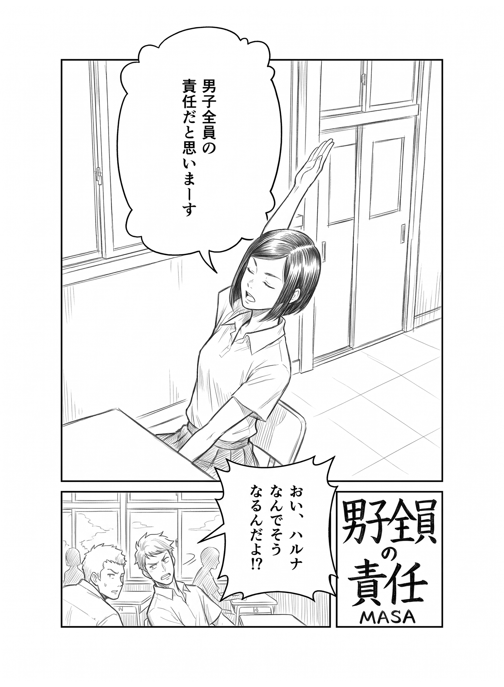
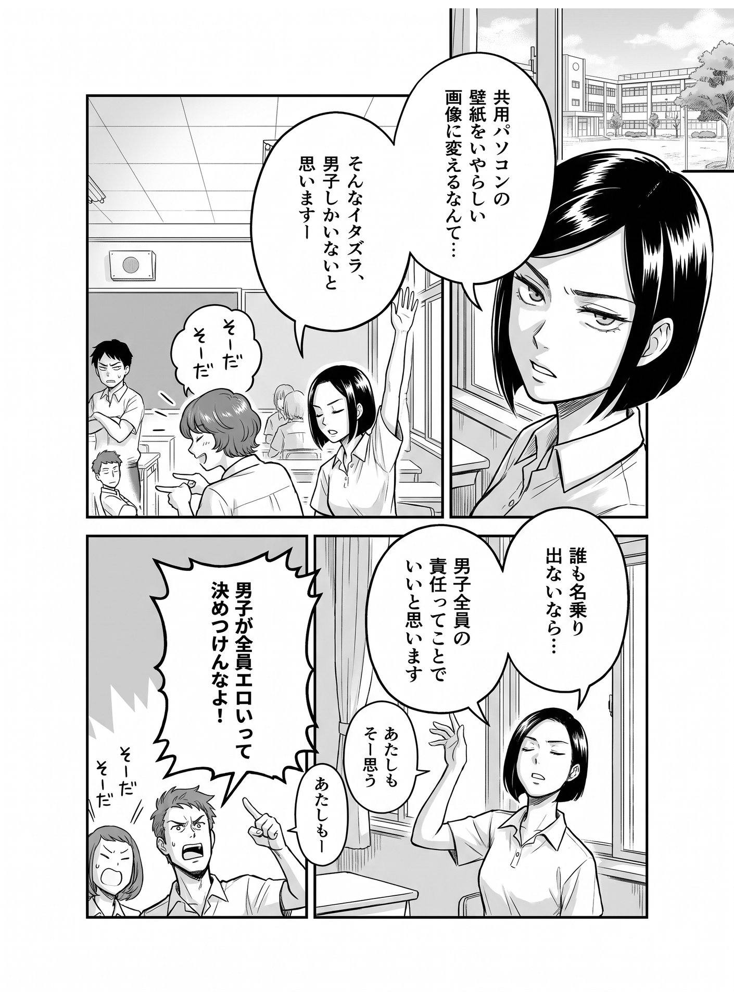
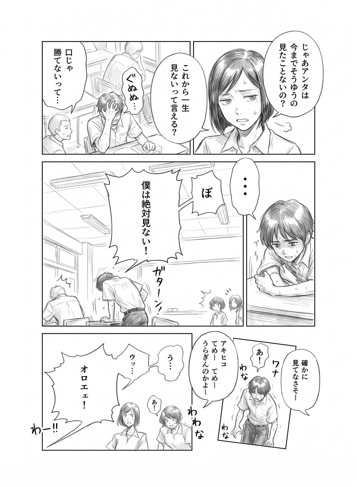
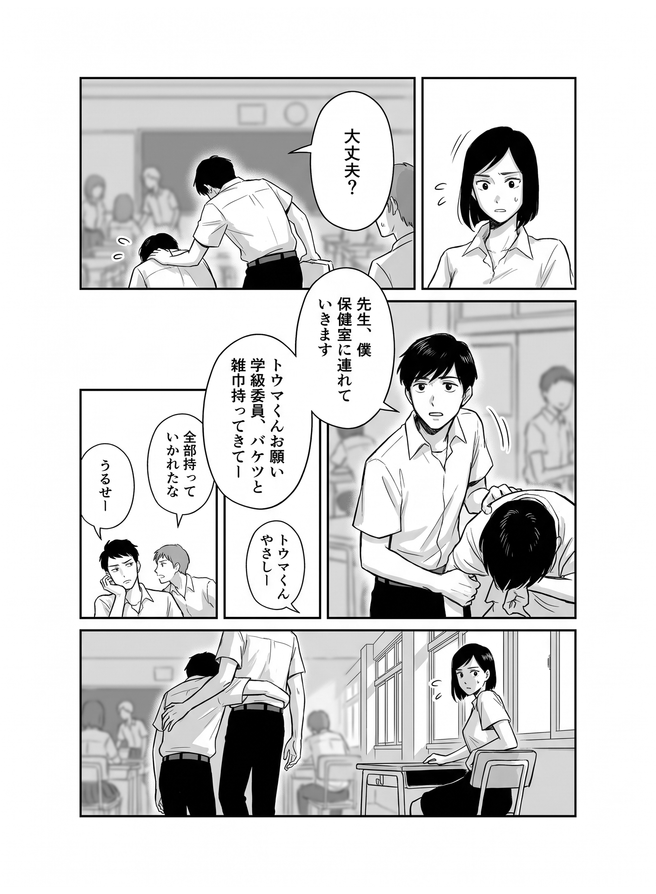
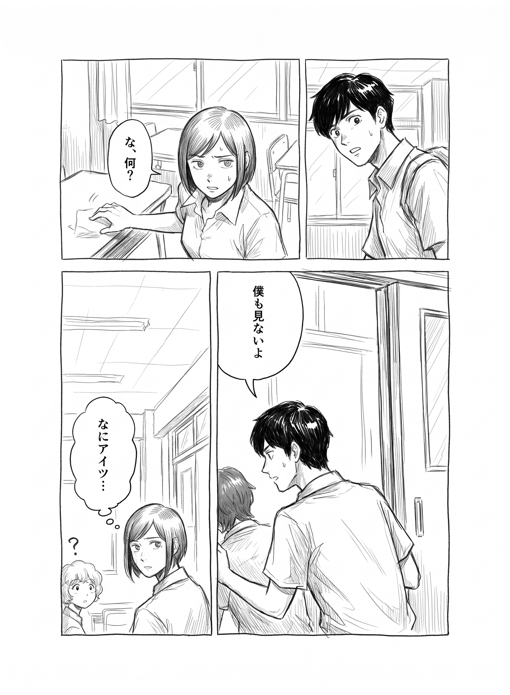
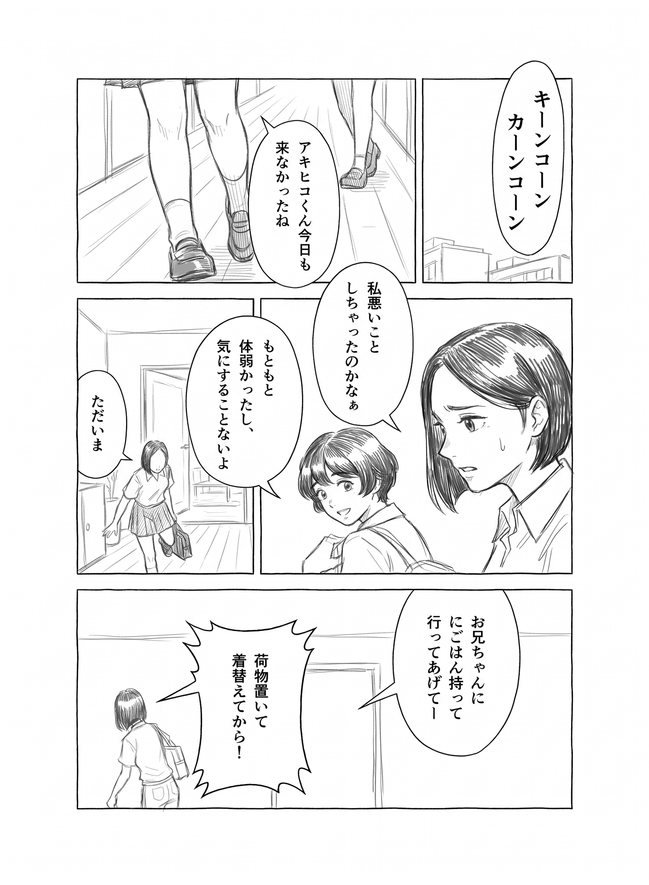
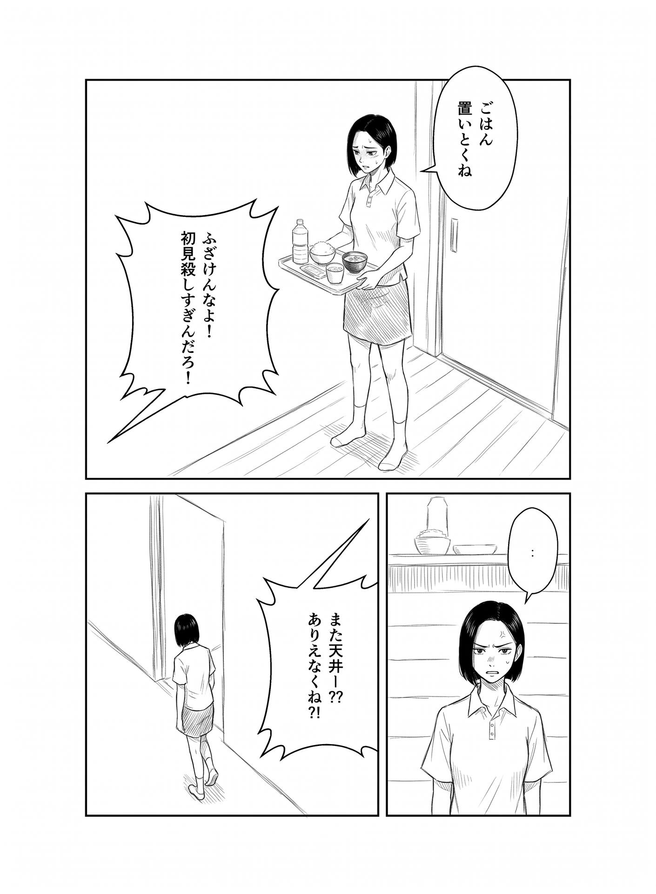
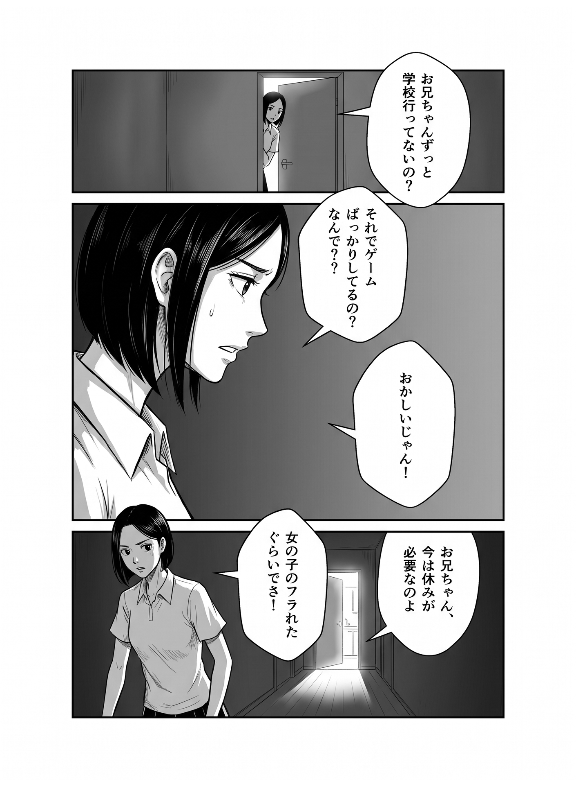

# 作例001：制作資料と生成した漫画

実際の漫画制作に使ったキャラクタースケッチ4枚、ネーム8枚、作画指示書8枚を収録しています。作品名は現在「作例001」としています。

| フォルダー | 内容 |
| --- | --- |
| `キャラクタースケッチ/` | Akihiko・Chinatsu・Haruna・Tohmaの設定画 |
| `ネーム/` | 01～08ページのコマ割り・セリフ・人物配置の下描き |
| `作画指示書/` | 同じページ番号の作画指示 |

原本のファイル名を保ち、`manifest.json` でページと資料を対応付けています。ネーム・指示書は1410×1920px、キャラクタースケッチは1920×1920pxです。

## ページごとの参照キャラクター

指示書の人物名をもとに、次の設定画を添付します。人物の身長など、資料で確定できない数値は設定していません。具体的な作画指示は指示書画像を参照し、本文への推測による書き足しはしていません。

| ページ | キャラクター |
| --- | --- |
| 01 | Haruna |
| 02 | Haruna、Chinatsu |
| 03 | Haruna、Chinatsu、Akihiko |
| 04 | Haruna、Tohma、Akihiko |
| 05 | Haruna、Tohma、Akihiko、Chinatsu |
| 06 | Haruna、Chinatsu |
| 07 | Haruna |
| 08 | Haruna |

## アプリへの登録

作品管理画面の「フォルダーを選択」で、この `example-001` フォルダー全体を選び、8ページと20枚の資料を確認して登録します。READMEやFinderの管理ファイルは読み飛ばします。登録だけでは画像生成は始まりません。

入力資料、登録設定、採用した漫画8ページ、却下候補、キャラクターリファレンスを公開しています。

番号に対応する文章の作画指示は、各ページの詳細画面にある「作画指示」で入力・保存できます。初回生成前にも入力でき、別のテキストファイルは不要です。資料と一緒に準備する場合は、`manifest.json` の各ページへ `page_prompt` を追加する方法も使えます。

## 生成結果と却下候補

- `生成結果/`：採用画像。ファイル名にページ・テイク番号を付けています。`出力一覧.csv` で対応を確認できます。未採用ページは含めません。
- `却下した候補/`：却下した画像。ページ・テイク番号付きで残し、`候補一覧.csv` に却下理由を記録します。

テイクは各ページの生成回です。同じページでも、採用した生成回が異なればテイク番号が異なります。

## キャラクターリファレンス

[キャラクターリファレンス](キャラクターリファレンス/)には、4人のスケッチからNano Banana 2.1で生成した設定画のテイク1、生成指示、候補一覧を収録しています。初回生成後、エージェントが作画用の暫定リファレンスとして4人分を選択しました。作者による品質採否は未実施です。4ページのテイク5への追加生成はエージェントの判断誤りで撤回しました。追加生成は失敗終了し、新しい画像候補はありません。採用済みの漫画8ページを公開しています。

## 採用した漫画8ページ

画像をクリックすると原寸で開けます。ZIPのダウンロードやアプリの起動は不要です。掲載8ページの生成時はキャラクタースケッチを直接参照していました。現在のアプリでは、採用したキャラクターリファレンスを使います。

| 1ページ · テイク1 | 2ページ · テイク1 |
| --- | --- |
|  |  |

| 3ページ · テイク1 | 4ページ · テイク4 |
| --- | --- |
|  |  |

| 5ページ · テイク2 | 6ページ · テイク4 |
| --- | --- |
|  |  |

| 7ページ · テイク3 | 8ページ · テイク2 |
| --- | --- |
|  |  |
